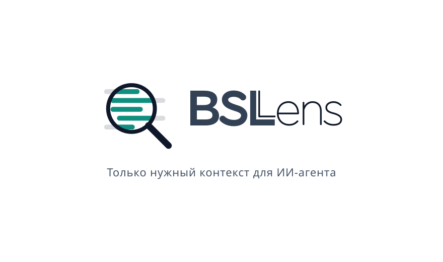

<picture>
  <source media="(prefers-color-scheme: dark)" srcset="assets/bslens-dark.svg">
  
</picture>

# BSLens

BSLens — ядро на Rust для навигации по структуре конфигурации 1С из точного Git-коммита.
Один и тот же структурный контекст предназначен для разработки и проверки изменений.

## Что работает сейчас

Экспериментальный библиотечный маршрут:

```text
полный SHA коммита → проверенные Git-объекты → ограниченный XML 2.21 → дерево до модулей
```

Дерево раскрывается страницами: конфигурация → вид объектов → объект → модуль.
Поддержаны Configuration, Catalog, Document и InformationRegister. Модули с
неподтверждённым владельцем показаны отдельно. Неподдержанные классы и вложенные
сущности вызывают явный отказ, а не исчезают из результата.

Изменения рабочей копии не подменяют данные выбранного коммита. Идентификаторы узлов
сквозного API привязаны к этому коммиту. Методы, граф вызовов, MCP и создание снимков
пока не входят в этот маршрут.

## Статус и ограничения

Это экспериментальная реализация на авторских тестовых данных. Поддержка полной БСП
и готовность к рабочей эксплуатации не заявляются. Штатный `ValidatedSnapshot::open`
закрыт до завершения полной проверки снимка. Ограниченный XML-слой не является
проверкой схемы XSD или семантики платформы.

Git-маршрут проверен только на Linux. Он использует доверенный системный Git,
не принимает произвольные команды, не запускает fetch и не меняет исходный репозиторий.
Backend для Windows требует отдельной реализации и проверки.

## Сборка и тесты

Rust 1.85.1, версии зависимостей закреплены в Cargo.lock.

```sh
cargo test --locked
cargo test --locked --features experimental-pipeline
cargo test --locked --all-features
```

При уже заполненном Cargo cache команды можно выполнять с `--offline`.
Без дополнительных features экспериментальные слои выключены.

## Библиотечный интерфейс

`pipeline::GitStructure::read(repo, commit, limits)` выполняет сквозное чтение.
`page(node_id, offset, limit)` возвращает детей одного узла и контекст commit/tree.
Для корня передаётся `None`; limit от 1 до 20. Список файлов вне выбранного XML/BSL
набора не интерпретируется, но их количество видно в контексте.

Для отдельных слоёв доступны `experimental-git`, `experimental-xml` и
`experimental-tree`. Отдельная `synthetic-dev` предназначена только для авторских
тестовых SQLite-снимков, её ответы явно помечены как непригодные для production.

[Сквозной контракт и ограничения](docs/adr-005-pipeline.md) ·
[Проверки сквозного маршрута](docs/testing-r05-a.md) ·
[Git-слой](docs/adr-003.md) · [XML-слой](docs/adr-002.md) ·
[Дерево структуры](docs/adr-004-structure.md)
